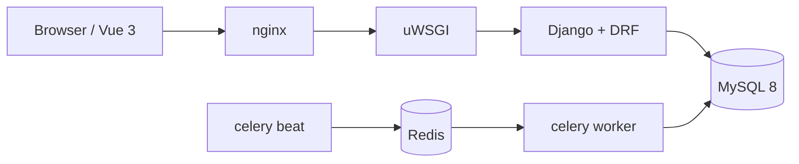

# commerce-core

一个可运行、可测试、可部署的电商交易闭环后端：登录、领券、按 SKU 下单、取消或模拟支付，超时订单自动关闭。

重点不在功能数量，而在**下单不超卖、重复请求与异步任务不产生重复副作用**。

## 技术栈

| 层 | 选型 |
|---|---|
| Web | Django 5 + DRF，uWSGI |
| 数据 | MySQL 8（InnoDB / utf8mb4） |
| 异步 | Celery worker + beat，Redis 作 broker |
| 前端 | Vue 3 + Vite + Vue Router + Pinia + axios + Element Plus |
| 部署 | Docker Compose + nginx；GitHub Actions + 阿里云 ACR |
| 测试 | pytest + pytest-django，含真实 MySQL 并发用例 |

## 链路



下单是同步事务：锁 SKU 行 → 扣减 → 核销券 → 写订单与明细快照。
关单是异步：beat 每分钟扫表，条件更新 + 同事务回补库存与退券。

## 本地运行

```bash
cp .env.example .env
docker compose -f deploy/docker-compose.yml up -d
docker compose run --rm api python manage.py migrate
docker compose run --rm api python manage.py seed_demo
```

前端：`cd frontend && npm install && npm run dev`（Vite 把 `/api` 代理到后端）。

## 测试

```bash
pytest -q
pytest -q -m concurrency      # 并发用例，需要真实 MySQL
python scripts/check_comments.py
```

## 目录

```
backend/       Django 应用
frontend/      Vue 3 SPA（4 个路由）
deploy/        compose、nginx、uWSGI、Dockerfile
experiments/   Redis 预扣实验，不接默认下单链路
scripts/       检查脚本
docs/          计划、修订记录、阶段记录
tests/         测试
```

## 非目标

不做注册、短信、第三方登录、真实支付与退款、购物车、地址簿、物流、图片上传、ES 搜索、完整优惠券引擎、监控告警全家桶。后台只用 Django admin，不作为公开业务后台。

## 说明

这是求职作品。Django / MySQL / Celery 部分为**项目级实操**，不宣称生产级高并发经验；压测只验证并发正确性，不提供 QPS 结论。
