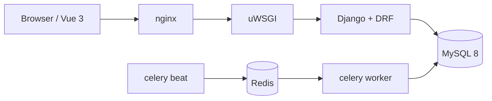

# commerce-core

一个可运行、可测试、可部署的电商交易闭环后端：登录、领券、按 SKU 下单、取消或模拟支付，超时订单自动关闭。

重点不在功能数量，而在**下单不超卖、重复请求与异步任务不产生重复副作用**。

## 技术栈

| 层 | 选型 |
|---|---|
| Web | Django 5 + DRF，uWSGI |
| 数据 | MySQL 8（InnoDB / utf8mb4） |
| 异步 | Celery worker + beat，Redis 作 broker |
| 前端 | Vue 3 + Vite + Vue Router + Pinia + axios + Element Plus |
| 部署 | Docker Compose + nginx；GitHub Actions + 阿里云 ACR |
| 测试 | pytest + pytest-django，含真实 MySQL 并发用例 |

## 链路



下单是同步事务：锁 SKU 行 → 校验库存 → 算总额 → 核销券 → 扣减 → 写订单与明细快照；
同一个 `client_token` 重试只落一单，返回原单并带 `X-Idempotent-Replay: 1`。
关单是异步：beat 每分钟扫表，条件更新 + 同事务回补库存与退券。

## 本地运行（Windows 开发）

前置：Python 3.12、Node 24、Docker Desktop。容器与数据卷只落在 compose 项目 `commerce` 下，不碰本机其它 compose 项目。

```bash
cp .env.example .env    # 填 DJANGO_SECRET_KEY 与 MYSQL_*，密码自己生成
docker compose -f deploy/docker-compose.yml --env-file .env up -d mysql redis
docker compose -f deploy/docker-compose.yml --env-file .env run --rm api python manage.py migrate
docker compose -f deploy/docker-compose.yml --env-file .env up -d api
```

后端也可以直接在本机跑（Windows 走 PyMySQL，不需要编译 mysqlclient）：

```bash
cd backend
py -3.12 -m venv .venv
.venv\Scripts\python -m pip install -r requirements-dev.txt
.venv\Scripts\python manage.py migrate
.venv\Scripts\python manage.py runserver 8000
```

健康检查：`http://127.0.0.1:8000/api/v1/health` 返回 `{"status":"ok","db":true,"redis":true}`；任一依赖不可用返回 503。

前端：`cd frontend && npm install && npm run dev`（Vite 把 `/api` 代理到 `127.0.0.1:8000`）。

## 测试

```bash
cd backend
pytest -q                        # 接口与探针契约，需要容器里的 MySQL/Redis 在跑
pytest -q -m concurrency         # 真实 MySQL 并发用例（S3 起：同 token 下单、超卖、重复取消）
.venv\Scripts\python -m stocklab.bench   # 手工压测 A/B/C，只出成功数与延迟，不产出 QPS（S4）
python scripts/check_comments.py backend   # 注释规范，见 AGENTS.md §6
```

CI 只跑 lint + test（`.github/workflows/ci.yml`）；build / push / deploy 按 plan §10.4 到 S7 再接。

## 目录

```
backend/       Django 应用（config/settings 分层、health 探针、tests）
backend/stocklab/  库存实验区：B 乐观锁对照、C 的 Redis 预扣/补偿/对账、压测脚本（不接主流程）
frontend/      Vue 3 SPA（四路由：/login、/products、/products/:id、/orders）
deploy/        compose、Dockerfile、uWSGI
scripts/       检查脚本
docs/          计划、修订记录、阶段记录
```

## 非目标

不做注册、短信、第三方登录、真实支付与退款、购物车、地址簿、物流、图片上传、ES 搜索、完整优惠券引擎、监控告警全家桶。后台只用 Django admin，不作为公开业务后台。

## 说明

这是求职作品。Django / MySQL / Celery 部分为**项目级实操**，不宣称生产级高并发经验；压测只验证并发正确性，不提供 QPS 结论。
