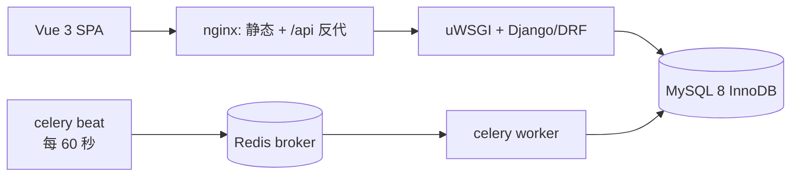

# commerce-core

一个可运行、可测试、可部署的电商交易闭环：登录 → 领券 → 按 SKU 下单 → 取消 / 超时关单 → 模拟支付。

**线上演示**：<http://120.24.67.82:8080>（无域名、无 HTTPS，端口 8080）

重点不在功能数量，而在三件事能被证明：

1. **下单不超卖**——并发守恒断言，且把保护拿掉测试必须变红；
2. **重复请求只有一个结果**——同 `client_token` 重放、重复取消、重复支付、重复回调都不产生第二次副作用；
3. **异步任务与同步链路共享同一套状态迁移**——取消和超时关单不会双回补。

> 这是求职作品。Django / MySQL / Celery 部分是**项目级实操**，不是生产级高并发经验。
> 压测只验证并发正确性与耗时量级，不提供 QPS 结论。

---

## 1. 线上是什么样

| 项 | 值 |
|---|---|
| 地址 | `http://120.24.67.82:8080` |
| 规格 | 阿里云轻量 2 vCPU / 1613 MB / 40 GB |
| 容器 | 6 个：api(uWSGI) / web(nginx+静态) / worker / beat / mysql / redis |
| 内存实测 | 容器合计约 **413 MiB**，系统 available **759 MB** |
| 部署方式 | push 到 main → GitHub Actions → ACR → ssh 上线 |

演示账号**不存在固定口令**。要试用请让维护者用下面的命令建一个（口令不写进仓库）：

```bash
docker compose -f docker-compose.yml exec -T api python manage.py create_demo_user
# 或不进容器：demopassword 由环境变量给，命令只建账号不打印
DEMO_PASSWORD=... python manage.py create_demo_user --reset
```

`/api/v1/orders` 需要登录（401），这是设计如此——订单接口不开放匿名访问。

---

## 2. 链路与状态机



**下单是同步事务**（顺序即约束 C6）：

```
锁 SKU 行（同时取价） → 校验库存 → 算总额 → 校验券门槛
→ 核销券 → F() 扣减库存 → 写订单 + 明细快照
```

**关单是异步的**：beat 每分钟投递任务，worker 扫出过期订单，每单走和"用户取消"完全相同的 service。

```text
创建订单 → PENDING ─┬─ 用户取消 ─────────→ CANCELLED（终态，回补库存 + 退券）
                     ├─ beat 超时(15 分钟)→ CLOSED   （终态，回补库存 + 退券）
                     └─ /pay 或回调 ──────→ PAID     （终态，写 paid_at，无跨表副作用）
```

状态迁移写在 `trade/rules.py` 的一张表里，执行靠 `services._apply_transition` 的**单条条件 UPDATE**
（`WHERE status=<旧状态>`），rowcount=1 的那一方才执行副作用。取消和关单同时到达时，只有一个人是赢家。

---

## 3. 几个值得说的设计

| 问题 | 做法 | 为什么 |
|---|---|---|
| 订单为什么要明细快照 | `OrderItem` 存 `title/unit_price/sku_code`，不靠 join SKU 现算 | 改价、下架、SKU 删除都不该改变历史订单 |
| 为什么唯一约束不够 | 领券：唯一索引只挡"同一人领同一张"，挡不住超发 → 条件更新 `issued_qty + 1 WHERE issued_qty < total_qty`；下单：`client_token` 唯一索引 + **捕获冲突后回查，且在 atomic 块之外** | 唯一冲突一旦在事务内回查，就会读到未提交前的快照或直接报错；先提交再查才是确定的 |
| 为什么取消/关单共用 service | 两者都只做"PENDING → 终态"，副作用一样 | 两套代码必然演化出双回补 |
| 为什么乐观锁 B 不进主流程 | 热点行 50 并发下 B 只成交 38–40/100 | 有限重试在热点上必然放弃一部分；这是取舍不是缺陷，但主流程要的是"排队的确定性" |
| 为什么 Redis 预扣 C 做了却不接主流程 | C 有真 Lua、补偿、对账，全部进 CI | 引入跨存储一致性就引入新的故障面；本项目的重点是"能证明"，不是"组件多" |
| 为什么 mock 支付也能讲幂等 | `/pay` 与 `/payments/callback` 共用 `mark_order_paid` | 幂等逻辑不依赖支付通道真假 |

### 库存三方案的实测（同一台开发机，2026-11-11）

条件：Python 3.12 + PyMySQL，50 条线程各自连接，200 请求 / 50 并发 / 100 库存 / 每单 1 件。
**这是并发正确性与耗时量级，不是 QPS。**

| 场景 | 成交 | 失败 | 剩余库存 | p50 | p95 | p99 |
|---|---|---|---|---|---|---|
| A 悲观锁·单 SKU 扣减 | 100 | `NOT_ENOUGH`×100 | 0 | 253 ms | 389 ms | 411 ms |
| B 乐观锁·3 次重试 | 40 | `RETRY_EXHAUSTED`×160 | 60 | 197 ms | 406 ms | 472 ms |
| B 乐观锁·10 次重试 | 99 | `RETRY_EXHAUSTED`×101 | 1 | 629 ms | 902 ms | 1009 ms |
| C Redis EVAL·预扣 | 100 | `INSUFFICIENT`×100 | 0 | 14 ms | 97 ms | 101 ms |
| A 完整下单 | 100 | `STOCK_NOT_ENOUGH`×100 | 0 | 475 ms | 733 ms | 765 ms |
| B 完整下单（单 SKU 无券） | 13 | `RETRY_EXHAUSTED`×187 | 87 | 361 ms | 455 ms | 462 ms |

两条口径必须分开看：

- **C 只做一次 EVAL 预扣**，A/B 是完整下单事务，直接比 p99 是错的；
- **B 的"卖不完"** 是有限重试的必然结果，不是 bug。热点场景下它换来的是不排队等锁。

复现：`cd backend && python -m stocklab.bench`（只出原始数字，不出 QPS）。

---

## 4. 接口

基线 `/api/v1`，`Authorization: Bearer <access>`，JSON；金额是字符串，时间是带时区的 ISO8601；
列表统一 `{count,next,previous,results}`；错误统一 `{code,message,detail?}`，前端只看 `code`。

| # | 方法与路径 | 鉴权 | 要点 |
|---|---|---|---|
| 1 | `POST /auth/login` | 匿名 | 返回 access/refresh/user |
| 2 | `POST /auth/refresh` | 匿名 + refresh | 换新 access |
| 3 | `GET /auth/me` | 登录 | 刷新页面恢复会话 |
| 4 | `GET /products` | 匿名 | 分页、keyword、排序白名单 |
| 5 | `GET /products/{id}` | 匿名 | 含 SKU 与库存 |
| 6 | `GET /coupons` | 可选 | 登录时带 `claimed` |
| 7 | `POST /coupons/{id}/claim` | 登录 | 201；重复/售罄 409 业务码 |
| 8 | `GET /me/coupons` | 登录 | `status=unused/used/expired` |
| 9 | `POST /orders` | 登录 | 201 新建；同 `client_token` 重放 200 + `X-Idempotent-Replay` |
| 10 | `GET /orders` | 登录 | 仅本人，按状态筛选 |
| 11 | `GET /orders/{order_no}` | 登录 | 他人订单一律 404，不泄露存在性 |
| 12 | `POST /orders/{order_no}/cancel` | 登录 | PENDING→CANCELLED；已取消返回 200 |
| 13 | `POST /orders/{order_no}/pay` | 登录 + `ENABLE_MOCK_PAY` | PENDING→PAID；已支付幂等 200 |
| 14 | `POST /payments/callback` | 匿名 + HMAC | 已支付 200 + `idempotent`；CLOSED/CANCELLED 409 |
| — | `GET /health` | 匿名 | 校验 db **与 redis**；任一不可用 503 |

回调签名：`HMAC-SHA256(order_no|trade_no|amount|timestamp)`，`compare_digest` 比较，
时间窗 ±300 秒，金额以服务端应付为准。

---

## 5. 本地运行

前置：Python 3.12、Node 24、Docker Desktop。

```bash
cp .env.example .env                      # 填 DJANGO_SECRET_KEY 与 MYSQL_*，密码自己生成

docker compose -f deploy/docker-compose.yml --env-file .env up -d mysql redis
docker compose -f deploy/docker-compose.yml --env-file .env run --rm api python manage.py migrate
docker compose -f deploy/docker-compose.yml --env-file .env run --rm api python manage.py seed_demo
docker compose -f deploy/docker-compose.yml --env-file .env up -d api
```

健康检查：`http://127.0.0.1:8000/api/v1/health` → `{"status":"ok","db":true,"redis":true}`。

前端：`cd frontend && npm install && npm run dev`（Vite 把 `/api` 代理到 `127.0.0.1:8000`）。

异步关单（Windows 上 beat 与 worker 必须分两个进程，`-B` 会被 Celery 拒绝）：

```bash
cd backend
.venv\Scripts\celery -A config worker -l info --pool=solo
.venv\Scripts\celery -A config beat -l info
```

**服务器同款全栈在本机预演**（和线上同一份 compose，需要 `deploy/.env`，模板见 `deploy/.env.prod.example`）：

```bash
cd deploy && docker compose -f docker-compose.prod.yml up -d
cd deploy && docker compose -f docker-compose.prod.yml run --rm -T api python manage.py migrate
```

> 容器名与本地栈相同，两套不能同时起；`docker compose run` 在无 TTY 的环境必须加 `-T`。

---

## 6. 测试与 CI

```bash
cd backend && pytest -q                    # 全部用例，需要真实 MySQL/Redis
cd backend && pytest -q -m concurrency     # 真实 MySQL 并发用例
cd backend && ruff check . && ruff format --check .
python scripts/check_comments.py backend   # 注释规范（本项目把注释当验收项）
cd frontend && npm run lint
```

测试不 mock 数据库：并发用例用独立连接开线程打真实 MySQL，断言的是**守恒**
（`剩余 + 成交 = 初始库存`）而不是"没报错"。CI 里 pytest 这一步连同环境准备约 1 分钟。

CI（`.github/workflows/ci.yml`）：

```text
push / PR  →  lint（ruff + 注释密度 + 依赖锁 + eslint）
           →  test（MySQL/Redis service + pytest）
main push  →  build & push（api 与 web 镜像，sha tag，推 ACR）
           →  deploy（ssh → 预检 → 迁移 → up -d → 健康检查 → 失败回滚）
```

---

## 7. 部署与回滚

镜像**只在 CI 构建**（服务器 1.6 GiB 会 OOM）。服务器只 `pull` + `up -d`。

```bash
# 线上当前版本
cat /opt/commerce-core/.current_tag      # 部署脚本写的
cat /opt/commerce-core/.previous_tag     # 上一版，回滚用

# 回滚：同一个脚本传旧 tag，不另写一套
cd /opt/commerce-core && ./deploy.sh <旧 sha>
```

`deploy/deploy.sh` 的顺序是硬性的：**预检（旧 tag 的 api+web 都在）→ 改 `.env` 的 IMAGE_TAG →
pull → migrate → up -d --remove-orphans → 60 秒内等 health 与首页都 200 → 记录 tag**。
失败时：还没起新栈就只回滚 `.env`；已经起过就切回上一版并确认站点恢复；上一版镜像不全则**明确拒绝**
并交人工，不假装回滚成功。

实测：一次换版 26–28 秒（镜像已拉到本机时），其中站点不可用窗口更短；不宣称零停机。

迁移纪律：**只做加法**，且先于 `up -d` 执行，旧代码必须能在新库上跑——这样回滚镜像时不用回滚数据库。

---

## 8. 目录

```
backend/
  config/      settings 分层（base/dev/prod）、URL 根表、分页、异常收口、Celery 应用
  accounts/    登录/刷新/me、Bearer 认证、token 错误分类、演示账号命令
  catalog/     商品与 SKU：模型、列表/详情、admin、seed_demo
  promotion/   券与用户券：领取（含并发约束）、我的券
  trade/       订单：状态规则表、下单/取消/关单/支付 service、回调签名、关单任务、六个接口
  stocklab/    库存实验区：B 乐观锁对照、C 的 Redis+Lua 预扣/补偿/对账、压测脚本（不接主流程）
  health/      就绪探针      common/  抽象模型与业务错误      scripts/  冒烟与依赖锁检查
frontend/      Vue 3 SPA：/login、/products、/products/:id、/orders
deploy/        compose（本地/生产）、Dockerfile（api）、Dockerfile.web、nginx conf、uwsgi.ini
docs/          plan.md（基线）、plan-changes.md（修订）、phases/（阶段证据）
```

---

## 9. 踩过的坑（都有现场）

| 问题 | 现象 | 处置 |
|---|---|---|
| worker/beat 起不来，健康检查还是绿的 | 镜像缺 `packaging`，kombu 的 redis transport 直接 import 它；api 不碰 broker 所以看不出来 | 依赖挪进 `requirements.txt`；结论是**健康检查覆盖不到的地方要有业务验收** |
| 只重建 api 不重建 web = 整站 502 | nginx 启动时解析一次上游地址并缓存，api 换 IP 后连不上 | 正常部署两个镜像一起换 tag；手工 `--no-deps` 后必须补 `restart web` |
| CI 部署"成功"但线上没变 | `部署` 步骤条件写成 `env.MODE == 'deploy'`，而 push 触发时 `inputs.mode` 为空 → 步骤 `skipped`，job 仍然绿 | 条件改成 `MODE != 'check'`；**验证部署要看服务器上的 tag，不看 job 颜色** |
| ACR 拒收镜像 | `denied: unknown manifest class for application/vnd.oci.empty.v1+json` | buildx 默认附 provenance/SBOM，ACR 个人版不认 → `provenance: false`、`sbom: false` |
| 服务器迁移命令"执行成功但退出码非零" | 无 TTY 时 `docker compose run` 的容器判定失败 | 一律加 `-T` |
| 高并发下连接数打满 | stocklab 50 线程 + 应用连接 > 50 | 本地 compose `max_connections=120`（线上仍 50，线上并发由 uWSGI 2×2 限制） |
| 乐观锁"卖不完" | 50 并发只成交 38–40/100 | **保留为结论**：有限重试在热点行上必然放弃一部分，加一列 10 次重试做对照 |

---

## 10. 边界与非目标

**不做**：注册、短信、第三方登录、真实支付与退款、购物车、地址簿、物流、图片上传、ES 搜索、
完整优惠券引擎、监控告警全家桶、多机/蓝绿部署。后台只用 Django admin（`/admin/` 公网返回 404）。

**明确已知的取舍**：

- 公网是 `http://`，没有域名和 HTTPS；`8080` 明文；
- `ENABLE_MOCK_PAY=true`：**任何登录用户都能把自己的待支付订单标成已支付**。这是演示取舍，
  不是支付功能；`/payments/callback` 的 HMAC 逻辑是完整的，但没有真实通道验证；
- 服务器上 `PAY_CALLBACK_SECRET` 未单独设置时回落到 `SECRET_KEY`；
- 回滚只回镜像，不回数据库（靠加法迁移保证旧代码能用新库）；
- 自动部署 = 单机 Compose 重建，重建期间有秒级不可用。

---

## 11. 如果被问到

- **为什么明细要快照**：历史订单不能因为改价/下架而变。
- **为什么唯一约束不够**：唯一索引解决"同一个 key 只能有一行"，解决不了"总量不能被超发"，
  后者要靠条件更新加 rowcount 判定。
- **取消与关单并发怎么保证只回补一次**：两者都走同一条条件 UPDATE，赢家才做副作用。
- **为什么乐观锁 version 对纯扣减是冗余**：`UPDATE ... WHERE stock >= qty` 本身就是原子的，
  version 只在"读-改-写"跨语句时才有意义；本项目的 B 是完整下单所以需要它。
- **为什么 C 不接主流程**：跨存储一致性会引入新的故障面，而本项目的目标是证明而不是堆组件。
- **为什么不能拿 C 的 p99 对比 A/B**：操作边界不同（一次 EVAL vs 一个完整下单事务）。
- **为什么镜像在 CI 构建、迁移只加法、回滚不回库**：服务器内存不够构建；回滚要能在不改库的情况下生效。
